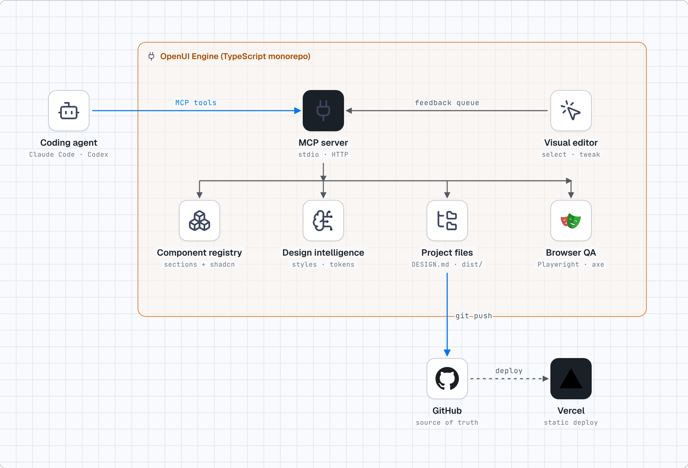
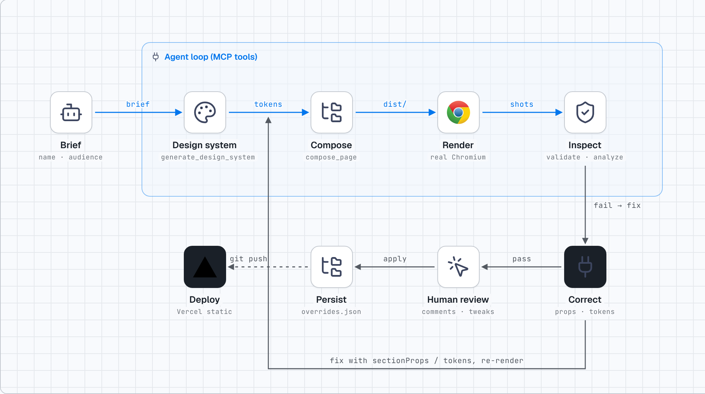

<div align="center">

# OpenUI Engine

**Design intelligence, a visual editor and real-browser QA for AI coding agents — exposed as an MCP server.**

[Apache-2.0](LICENSE) · TypeScript · MCP (stdio + Streamable HTTP) · Playwright · by [Amit Elgabsi](https://github.com/amitamit10)

</div>

Cheap coding models are fine at code and poor at *design decisions*. OpenUI Engine moves those decisions out of the model:
it hands the agent a **curated, compatibility-checked component registry**, a **WCAG-verified design system** (`DESIGN.md` + tokens), a **browser editor** where a human can comment and tweak, and a **Chromium QA gate** that proves the page actually looks right — then lets the agent iterate until it does.



## What's in the box

| Package | What it does |
|---|---|
| [`@openui-engine/core`](packages/core) | Art directions (12), token generator + WCAG linting, DESIGN.md / DTCG / CSS exporters, component registry with structured compatibility metadata, composition checker, reference/pattern search, section renderers and page builder |
| [`@openui-engine/verify`](packages/verify) | Playwright audit: overflow, axe-core, console/network errors, broken assets & anchors, interaction tests, reduced-motion, invisible-content detection, **design-token compliance**, pixel-scan whitespace analysis, heuristic quality scoring |
| [`@openui-engine/editor`](packages/editor) | Browser editor: select, comment, live-tweak typography/spacing/colour/radius/shadow/layout, switch component variants, natural-language requests → agent. Token-authenticated sessions |
| [`@openui-engine/mcp-server`](packages/mcp-server) | The MCP server (`openui-engine-mcp`) and a protocol-level CLI client (`openui-engine-call`) |

### MCP tools (26)

| Tool | Purpose |
|---|---|
| `discover_components` | Short ranked list (fit score + reason + install command) for a slot/style — never the whole registry |
| `get_component` | Metadata, compatibility, licence status; `detail=source` returns an example (OpenUI) or **live-fetched** registry source |
| `search_design_references` | Composition patterns (principles, pitfalls, implementing components) + audited inspiration-source status |
| `generate_design_system` | Chooses an art direction from the brief; writes `DESIGN.md`, `tokens.json` (DTCG), `tokens.css`, `openui.tokens.json`; returns lint |
| `suggest_layout` | Surface-first section sequence with reasons |
| `compose_page` | Create/update a project and render `dist/` (static, deployable). Edit copy via `sectionProps`, restructure via add/remove |
| `update_design_tokens` / `rebuild_project` | Change tokens by path and re-render |
| `validate_design` | The QA gate (desktop/tablet/mobile) with fix-oriented issues that carry the element selector, its visible text and the section id. `quick: true` runs a faster desktop-only check without axe-core while iterating. It also flags near-invisible text, large empty holes in card grids and, on right-to-left pages, physical left/right CSS |
| `capture_preview` | Real screenshots returned as images so a multimodal model can *look* |
| `analyze_visual_quality` | Evidence-backed scores (measured vs heuristic labelled) |
| `create_review_session` | Starts the editor, returns a private tokenised URL |
| `get_visual_feedback` | Comments, requests and pending tweaks as CSS patches; long-poll supported |
| `apply_visual_tweaks` | Persist approved tweaks to `openui.overrides.json` (id-keyed CSS) and rebuild |
| `brief_template` / `build_site` | **The one-call path.** `brief_template` returns an example `SiteBrief` plus rules for a category (any free text is accepted); `build_site` plans art direction, layout and tokens, renders the page, lints the copy, runs the browser QA gate with the anti-slop detector and returns screenshots plus a design review and image slots. Re-call with a `patch` to fix what it reports |
| `illustration_kit` | Palette variables, scene and object library and an example drawing, so the model can draw a *specific* flat SVG for the hero or a feature (a sanitiser keeps it safe; short text labels are allowed) |
| `search_icons` | Offline search over 9,000+ icons (Lucide, Phosphor, Heroicons, Tabler) |
| `search_photos` | Stock fallback: 120 hand-tagged Unsplash-licensed photographs for `heroPhoto` and `features[].photo` |
| `image_requests` / `add_image` | Image slots (hero, feature photos, logo) with a ready-to-paste generation prompt each, and a way to drop a finished image into a slot and rebuild (see **Images and logos** below) |
| `generate_logo` | Preview simple geometric logo marks, favicon and logo SVG. These are placeholders, not a designed brand logo |
| `generate_palette` | A brand accent with colour harmonies, the token set of the best-matching art directions and WCAG contrast checks |
| `legal_kit` | Copyright line plus template privacy and terms text; `brief.legal.pages` writes `privacy.html` and `terms.html` |
| `detect_ai_slop` | Flags generic AI-template patterns on a built page |
| `list_libraries` | The audited component and inspiration sources and their licence status |

## Images and logos

The engine never invents image URLs. Photos and the logo go into the brief as **prompts**, and the build shows a labelled placeholder carrying the prompt (slot name, aspect ratio, file name) until a real image exists:

1. The model first decides whether it can generate images itself. If it can, it generates each slot's prompt and saves the result with `add_image`.
2. If it cannot, it tells you to copy-paste each prompt into ChatGPT (or any image generator), save the result as `images/<slot>.png` in the project (`hero`, `feature-1`, `logo` and so on), and run `rebuild_project`. The placeholders are swapped for the real images, which are copied into `dist/images/`.
3. The logo works the same way. The default is a clean text wordmark, which is fine to ship. A designed logo is optional (`images/logo.svg` or `.png`, which also becomes the favicon). The model may supply its own SVG only if it is genuinely professional.

`brief.heroPhoto: <id>` or `features[].photo: <id>` use the bundled stock library instead. All images get `width`/`height` and alt text. Library photos are credited in the footer.

## Quick start

```bash
git clone https://github.com/amitamit10/openui-engine && cd openui-engine
pnpm install && pnpm build            # Node ≥ 20; set OPENUI_CHROMIUM=/path/to/chrome if Playwright's cache is not present
node packages/mcp-server/dist/call.js list                      # real MCP round-trip over stdio
node packages/mcp-server/dist/call.js generate_design_system '{"name":"Acme","description":"dark AI platform","outDir":"acme"}'
node packages/mcp-server/dist/call.js compose_page '{"projectDir":"acme","brief":{"name":"Acme","description":"…"}}'
node packages/mcp-server/dist/call.js validate_design '{"target":"acme"}'
```

Register it with your agent → **[docs/MCP_SETUP.md](docs/MCP_SETUP.md)** (Claude Code, Codex, Cursor, generic stdio and remote HTTP).

## The loop



`Generate → Render → Screenshot → Inspect → Correct → Verify` — a successful build is not treated as a visually correct site. The gate has already paid for itself during development: it found invisible content after scroll (smooth-scroll vs IntersectionObserver), three contrast failures in non-default styles, and a WCAG failure for pure-red brand colours that the unit test suite then locked down.

## Design intelligence, not keyword search

* **Art directions** are the "pick a style and get a lot of ready-made things" unit. Twelve ship: `aurora-dark`, `clarity-light`, `editorial-paper`, `terminal-dev`, `warm-human`, `neo-brutal`, `field-notes`, plus five added in v0.7: `shadcn-mono` (neutral zinc product UI in the shadcn manner), `material-tonal` (rounded Material-style tonal surfaces), `swiss-grid` (strict grid, heavy grotesk, signal red), `noir-luxe` (warm black, serif, gold) and `pastel-play` (soft, rounded, cheerful). Choosing one sets type ratio, palette, radii, shadows, motion budget, hero composition, CTA hierarchy, image direction, logo-mark family, illustration motifs and the signature CSS of the page, so every section, illustration and image prompt agrees. Each has signatures and *don'ts*. Design sources behind them: [shadcn/ui](https://ui.shadcn.com/) (MIT), [Untitled UI React](https://www.untitledui.com/react/components) (MIT) and [MUI / Material UI](https://mui.com/) (MIT), all licence-checked in [docs/SOURCES.md](docs/SOURCES.md); no third-party code is copied.
* **Compatibility**: each component declares styles it is native to, motion energy, density, runtimes (Radix vs Base UI, GSAP vs Motion), framework and licence status. `checkComposition` flags framework mixes, duplicate slots, animation-runtime mixes, energy spread and style misfits.
* **Tokens are enforced**, not decorative: the verifier computes colour/font/size/spacing/radius compliance of the rendered DOM against `tokens.json`.
* **DESIGN.md** follows Google's alpha spec and is checked with the official linter in CI.

## Visual editor

`create_review_session` → open the URL → click any element → change type, spacing, colour, radius, shadow, layout → comment → "Ask agent". Everything reaches the agent through `get_visual_feedback`; **Apply** persists tweaks as stable `[data-openui-id="…"]` rules in `openui.overrides.json`, regenerates the site, and the diff is reviewable in git. Any localhost dev server can be reviewed too (tweaks are then returned as CSS patches).

Security: loopback only by default, 192-bit per-session secret exchanged for an HttpOnly/SameSite=Strict cookie, Host allow-list (DNS-rebinding), Origin + JSON-only mutations (CSRF), CSP, 64 KB body cap, rate limit, SSRF guard on proxy targets, property/value allow-list for persisted CSS, 8 h expiry, secrets never written to disk. See [SECURITY.md](SECURITY.md).

## Sources & licences

Component and inspiration sources were audited with real HTTP probes — **including the ones that turned out to be blocked, paid or moved** — in [docs/SOURCES.md](docs/SOURCES.md). Third-party component source is never vendored; it's fetched from each project's own registry on demand. The author's private skill collection audit is in [docs/SKILLS_AUDIT.md](docs/SKILLS_AUDIT.md). Component inventory: [docs/COMPONENTS.md](docs/COMPONENTS.md).

## Benchmark (read before quoting it)

**Latest result (v0.15.0, read this too):** on six unseen categories Haiku with the engine's tools beat plain Haiku 10 of 12 (v0.14.0), but a no-engine control required to review its own screenshots beat that engine arm 9 of 12 (v0.15.0). The v0.14.0 win is explained by iteration depth, not engine content.

**Earlier headline:** across fifteen controlled runs, an unguided Haiku 5.5 beat the same model using the engine's page generator in blind pairwise judging in 117 of 130 judgements (see the table below). The last four runs went 0, 0, 3 and 1 wins of 8 for the engine (4 of 32): v0.11.0's 3 of 8 did not repeat in v0.12.0 (7 to 1), so it was most likely a favourable draw, not a step change. Between them, a change meant to help colour (brand-tinted surfaces) made colour worse and was reverted, and a bug that stripped the size from rectangle-based icons in every build was fixed, so the improvement cannot be attributed to any single change. The engine's own gate scores (95 to 100) do not predict the blind judgements. Where the engine did win, the hero was a specific product mockup. Every run used a **substitute model** (`claude-haiku-5-5`; GPT-6 Luna is unavailable here), small samples (n = 8 judgements per run) and sealed, position-swapped Sonnet judges. Nothing was deployed to Vercel (no credentials in the session), so no live URLs are claimed.

The original first experiment, for the record. Headline findings, in order of importance:

* The "engine available" agent **made zero MCP calls**, so it was effectively a second baseline; a third arm with *required* engine use was added.
* In a **blind design review the engine-built page ranked last**; measured token discipline (12 vs ~30 colours, 9 vs 14–17 font sizes) and zero sub-12 px text *were* better. Accessibility/overflow/function were indistinguishable.
* **No Vercel deployment was possible** (no credentials in the session); no live URLs are claimed.
* n = 1 per arm. This is **not** evidence that the engine improves a cheap model's design — see [`results/v0.1.0/REPORT.md`](results/v0.1.0/REPORT.md) for confounds, the three flaws it exposed (all fixed) and the open gap (generic composition). Interactive side-by-side: [`results/v0.1.0/site`](results/v0.1.0/site/index.html).

## Results by release

Each release is tested the same way (same spec, clean workspace, Haiku 5.5 builder with and without the engine, neutral measurements, blind pairwise judging of screenshots). Full tables, every unsealed verdict and raw data: [`results/`](results/README.md).

| release | judged pairs | engine wins | judge mean (baseline / engine) | engine originality | engine product visual | engine tokens per agent | tool calls |
|---|---|---|---|---|---|---|---|
| [v0.2.0](results/v0.2.0/REPORT.md) | 6 | 0 | 7.9 / 5.6 | 3.5 | 5.2 | 118,871-145,517 | 42-62 |
| [v0.2.1](results/v0.2.1/REPORT.md) | 12 | 0 | 7.9 / 5.6 | 3.3 | 4.5 | 75,739-96,362 | 17-36 |
| [v0.3.0](results/v0.3.0/REPORT.md) | 12 | 0 | 7.8 / 5.8 | 5.1 | 6.0 | 88,456-104,393 | 23-40 |
| [v0.3.1](results/v0.3.1/REPORT.md) (replay) | 12 | 2 | 7.7 / 6.5 | 5.6 | 7.2 | n/a (no model run) | n/a |
| [v0.3.1 held-out](results/v0.3.1-heldout/REPORT.md) (4 new briefs, fresh agents) | 8 | 1 | 7.5 / 6.1 | 5.6 | 6.6 | 80,420-95,448 | 21-29 |
| [v0.4.0](results/v0.4.0/REPORT.md) (4 more new domains, fresh agents) | 8 | 1 | 7.6 / 6.3 | 5.5 | 7.4 | 77,598-95,242 | 14-30 |
| [v0.5.0](results/v0.5.0/REPORT.md) (illustration layer; 4 new domains) | 8 | 1 | 7.5 / 6.6 | 6.3 | 7.5 | 85,541-125,121 | 18-50 |
| [v0.5.1](results/v0.5.1/REPORT.md) (drawn domain scenes; **worse**) | 8 | 0 | 7.7 / 6.0 | 4.9 | 5.3 | 78,651-126,416 | 17-40 |
| [v0.6.0](results/v0.6.0/REPORT.md) (model-drawn SVG art; 4 new domains) | 8 | 1 | 7.6 / 6.3 | 5.6 | 6.0 | 108,281-112,685 | 17-32 |
| [v0.7.0](results/v0.7.0/REPORT.md) (+ photo/logo/palette/legal tools, image prompts; 4 new domains; spec forbids external images) | 8 | 1 | 7.7 / 6.6 | 5.8 | 6.6 | 101,494-153,494 | 18-38 |
| [v0.8.0](results/v0.8.0/REPORT.md) (+ five new art directions, two-tone colour, defect fixes; 4 new domains; spec forbids external images) | 8 | 2 | 7.6 / 6.5 | 6.0 | 6.8 | 109,155-119,984 | 20-29 |
| [v0.9.0](results/v0.9.0/REPORT.md) (+ gate checks, two-tone, layout fixes; 4 new domains; spec forbids external images) | 8 | 0 | 7.7 / 6.4 | 5.5 | 6.8 | 105,389-129,433 | 18-40 |
| [v0.10.0](results/v0.10.0/REPORT.md) (+ brand-tinted surfaces, RTL, gate checks; 4 new domains; spec forbids external images) | 8 | 0 | 7.7 / 6.0 | 4.9 | 6.1 | 112,796-133,694 | 17-32 |
| [v0.11.0](results/v0.11.0/REPORT.md) (+ icon fix, tint reverted, style keywords; 4 new domains; spec forbids external images) | 8 | 3 | 7.3 / 6.8 | 6.1 | 6.5 | 103,575-118,324 | 18-24 |
| [v0.12.0](results/v0.12.0/REPORT.md) (+ section-title fields, brief key aliases; 4 new domains; spec forbids external images) | 8 | 1 | 7.6 / 6.7 | 6.3 | 6.5 | 99,128-124,032 | 16-25 |
| [v0.14.0](results/v0.14.0/REPORT.md) (6 new categories; free-choice engine tools, mostly hand-written pages; baseline = Haiku alone) | 12 | 10 | 7.0 / 7.6 (baseline / engine arm) | - | - | 103k-143k | 18-33 |
| [v0.15.0](results/v0.15.0/REPORT.md) (same briefs: **no-engine control told to iterate** vs the v0.14.0 engine arm; **control won 9-3**) | 12 | 3 | 7.6 / 7.0 (control / engine arm) | - | - | 125k-162k (control) | 22-36 (control) |
| [hybrid v0.4.1](results/hybrid-v0.4.1/REPORT.md) (hand-written page + engine QA tools; 4 more new domains; "engine" columns = hybrid arm) | 8 | 7 | 6.9 / 7.6 | 7.6 | 7.6 | 104,474-125,480 | 18-29 |
| [control v0.4.1](results/control-v0.4.1/REPORT.md) (same, **no engine tools**): vs hybrid 4-4, vs baseline 4-4 | 16 | n/a | 7.17 / 7.33 (baseline/control) | - | - | 110k-144k | 13-40 |

What the data says, plainly:

* **The generator path loses.** Letting the engine compose the whole page from a structured brief (`build_site`) lost the blind comparison to an unguided Haiku in 117 of 130 judgements across fifteen runs (it won 13: 2 in a replay tuned to the judged set, 11 on fresh briefs), including fresh agents on unseen domains (v0.3.1 held-out 1/8, v0.4.0 1/8). The pages are clean (0 audit errors vs 4-7 on baselines) and its product visuals are now competitive, but judges find them uniform "software templates" even for a bakery or a law firm. The v0.3.1 replay (2/12) is not independent evidence.
* **The hybrid path looked like a win, then a control ate it.** When the model writes the page by hand but also runs the engine's QA tools and fixes what they find, it won 7 of 8 blind pairs against the unguided baseline on four unseen domains. But that arm also had a "make your own design decisions" instruction and more iteration, so I ran the control that removes only the engine tools ([control-v0.4.1](results/control-v0.4.1/REPORT.md)): same instruction, same *required* self-review loop with plain Playwright. **The control tied the hybrid 4-4 and tied the baseline 4-4** (means 7.30 vs 7.25, and 7.17 vs 7.33). So on judged design quality the three hand-written arms are statistically indistinguishable at this sample size, and the earlier 7/8 should not be credited to the engine.
* **What the engine's tools do demonstrably do:** the hybrid shipped **0 audit errors on all four sites**, against 7 for the control (despite its required self-review) and 11 for the baseline (axe-type contrast, overflow and tap-target problems that hand-rolled checks missed). Caveat: the hybrid agents optimised against that same gate, so it is partly circular, though the accessibility violations are real defects regardless of who measures them.
* **What nothing here shows:** that the engine makes a cheap model's UI *look better*. Generator path: clearly worse (54 of 58 judgements lost). QA-tool path: better at correctness, not shown better at design. Samples are small (n = 4 briefs, 8 judgements per comparison; Sonnet judging Haiku from screenshots).
* **Bugs the runs found** (all fixed, with regression tests): hero overlap on mobile, a feature silently dropped, a chart crash, hero chips covering content, a made-up "Save 20%" badge, and a QA-gate false positive that flagged every hand-written page for "no primary CTA".

Regenerate with `node benchmark/summarize.mjs`.

## Status & honest limitations

* Output target today is **static HTML/CSS/JS** with original sections (zero runtime deps). React/shadcn/Fluid components are *discoverable and installable* but not composed into generated pages yet.
* `analyze_visual_quality` measures engineering quality; it cannot judge taste, brand fit or imagery. Always look at `capture_preview`.
* Third-party licences are marked *unverified* where the upstream repositories were not reachable from the audit sandbox. shadcn/ui, Untitled UI React and Material UI were verified as MIT from their LICENSE files on 2026-11-03; no third-party component code is copied into generated pages.
* **Page generation does not yet beat an unguided cheap model** in blind judging (see the results table). The engine is strongest on correctness (zero audit errors, consistent tokens, accessible markup) and weakest on distinctive, specific composition. Treat it as a fast way to a clean, accessible, consistent page, not yet as a way to a more impressive one.
* **Right-to-left:** `brief.lang` set to a right-to-left language (`ar`, `he`, `fa`, `ur`...) sets `dir="rtl"` and builds the stylesheet with CSS logical properties so the layout mirrors. Not yet handled: the engine does not translate or write the copy, its bundled Latin web fonts do not cover Arabic or Hebrew glyphs (system fonts take over), icons and drawn art are not mirrored, and keyboard arrow direction in the feature tabs is not swapped.
* The photo library is generic (120 photos, mostly workspaces, landscapes and objects); anything specific needs generated or supplied images, via the prompt flow above.
* The editor persists to OpenUI projects; arbitrary codebases get CSS patches, not source rewrites.

## Development

```bash
pnpm build && pnpm typecheck && pnpm lint && pnpm test   # unit + browser e2e (needs Chromium)
pnpm run docs:build && pnpm run site:build                  # regenerate inventories and the docs site (itself built with the engine)
```

## Attribution

Created by **Amit Elgabsi** ([@amitamit10](https://github.com/amitamit10)). Attribution lives in this README, `NOTICE` and the docs site footer. **Generated client sites contain no backlinks or hidden credits.** Diagrams made with [stack-diagram](https://github.com/caru-ini/stack-diagram) (MIT).
