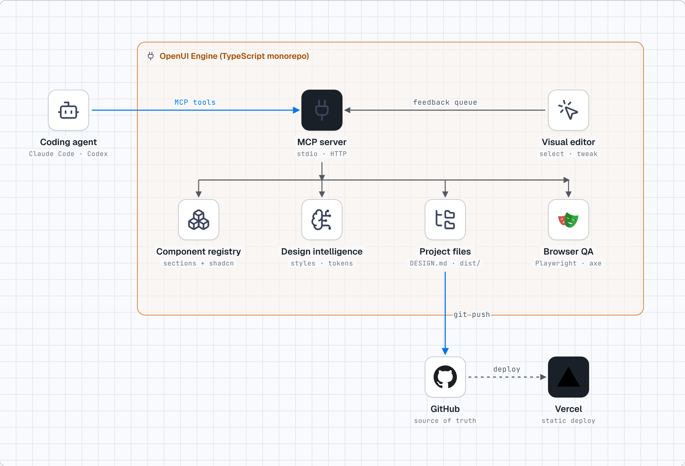
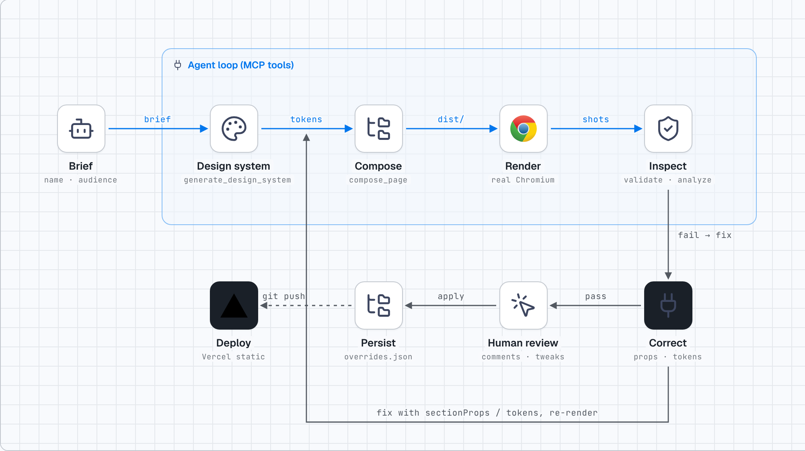

# Architecture

(Interactive/self-contained versions: [architecture.html](diagrams/architecture.html), [quality-loop.html](diagrams/quality-loop.html); light + dark PNGs alongside. Generated from `docs/diagrams/make_diagrams.py` with the stack-diagram skill.)

## Data flow
1. **Agent → MCP** (`stdio` or Streamable HTTP). Tools are thin; all logic lives in packages.
2. **core** is pure and deterministic: brief → art direction → `DesignTokens` → (`tokens.css`, `DESIGN.md`, `tokens.json`); page spec + tokens → static site. Same input ⇒ same output, which is what makes tests and diffs meaningful.
3. **A project is a plain folder** — `openui.tokens.json` (source of truth), `openui.page.json` (sections + copy), `openui.overrides.json` (reviewer tweaks keyed by `data-openui-id`), generated `DESIGN.md`/`tokens.*`, and `dist/`. Nothing is hidden state; everything is reviewable in git.
4. **verify** serves `dist/` on loopback, drives Chromium, and emits issues with `openuiId` + `fix` so an agent can address them via `sectionProps`/tokens.
5. **editor** injects an overlay into the preview (same-origin `postMessage`), keeps sessions in memory (persisted without the secret), and exposes a long-poll feedback queue to the MCP tools in the same process.

## Why original sections instead of bundling third-party components
Licence uncertainty, bundle size and style drift. Original sections are token-driven so *every* style stays consistent; third-party registry items are indexed with compatibility metadata and fetched live for projects that want React.

## Extending
* **New section**: add a renderer in `compose/sections.ts`, CSS in `compose/css.ts`, an entry in `registry/components.ts` — the unit test enforces renderer ⇄ registry parity and the audit enforces quality.
* **New art direction**: add to `design/styles.ts`; the property tests then check WCAG for arbitrary brand accents.
* **New registry**: add a base in `registry/components.ts` and curated entries (energy, density, runtimes, licence status).
